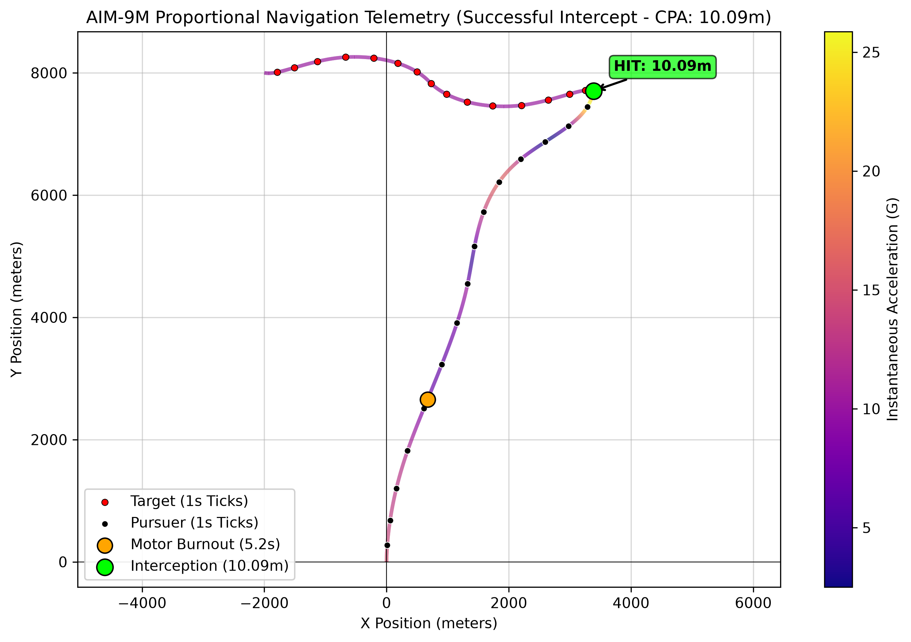

# 2D Proportional Navigation Guidance Simulation (AIM-9M)





A Python simulation modeling an AIM-9M Sidewinder pursuing an evasive target using Proportional Navigation (PN). Features boost-coast propulsion, quadratic aerodynamic drag, and structural G-load limits.


## 1. Quick Start


### Dependencies

```bash

pip install numpy matplotlib

```


### Run

```bash

python main.py

```


---


## 2. Mathematical Formulation


### Kinematics

Given pursuer position $\vec{r}_P$ and target position $\vec{r}_T$, relative position (Line of Sight) and relative velocity are:


$$\vec{r} = \vec{r}_T - \vec{r}_P$$


$$\vec{v}_{\text{rel}} = \vec{v}_T - \vec{v}_P$$


### Closing Velocity ($V_c$)

$$V_c = -\frac{\vec{r} \cdot \vec{v}_{\text{rel}}}{\|\vec{r}\|}$$


### Line-of-Sight Rate ($\dot{\lambda}$)

$$\dot{\lambda} = \frac{r_x v_{\text{rel},y} - r_y v_{\text{rel},x}}{r_x^2 + r_y^2}$$


### Proportional Navigation Steering Law

When actively closing ($V_c > 0$) or within terminal range ($\|\vec{r}\| < 100\text{ m}$):


$$a_{\text{lat}} = N \cdot V_c \cdot \dot{\lambda} \quad (N = 4.0)$$


Clamped by the airframe G-limit ($30\text{G}$):


$$\|a_{\text{lat}}\| \le 30.0 \times 9.81 \text{ m/s}^2$$


To enforce Pure PN (Zero-Work Turning), lateral acceleration is applied perpendicular to velocity:


$$\vec{a}_{\text{lateral}} = a_{\text{lat}} \begin{bmatrix} -u_{v,y} \\ u_{v,x} \end{bmatrix}$$


### Propulsion & Aerodynamic Drag

* **Boost Phase ($t \le 5.2\text{ s}$):** Thrust $T = 12,800\text{ N}$

* **Coast Phase ($t > 5.2\text{ s}$):** Thrust $T = 0\text{ N}$

* **Drag ($D$):** $D = 0.5 \rho \|\vec{v}_P\|^2 C_d A$


---


## 3. Code Structure


* **`main.py`:** Runs the $dt = 0.001\text{ s}$ simulation loop, steps vehicles, checks the $10\text{ m}$ blast radius, and triggers plotting.

* **`utility.py`:** Computes LOS rate, closing velocity, and gated PN lateral acceleration with thrust and drag.

* **`vehicle.py`:** Defines the Vehicle class, handling explicit Euler integration and telemetry history logging.

* **`plotter.py`:** Renders trajectories, acceleration-colored velocity paths (`plasma` colormap), burnout points, and closest approach (CPA) markers.


---


## 4. Simulation Results & Endgame Analysis


* **Pursuer:** Starts at $(0,0)\text{ m}$, $200\text{ m/s}$ at $45^\circ$, $85.5\text{ kg}$, $30\text{G}$ max.

* **Target:** Starts at $(2000,2000)\text{ m}$, $300\text{ m/s}$ at $45^\circ$, $10\text{G}$ sinusoidal weave.

* **Outcome:** Achieves a Closest Point of Approach (CPA) of $\le 11\text{ m}$, triggering a successful intercept within the AIM-9M's warhead blast radius.


### Why PN Degrades in the Endgame

* **Target Weaving:** Continuous $10\text{G}$ target maneuvering keeps $\dot{\lambda}$ non-zero.

* **Energy Bleed:** Post-burnout parasitic drag ($D \propto v^2$) reduces speed during the tail-chase.

* **Closing Velocity Decay:** As the missile passes close by, $\vec{r}$ becomes orthogonal to $\vec{v}_{\text{rel}}$, causing $V_c \to 0$ and temporarily starving steering authority.
